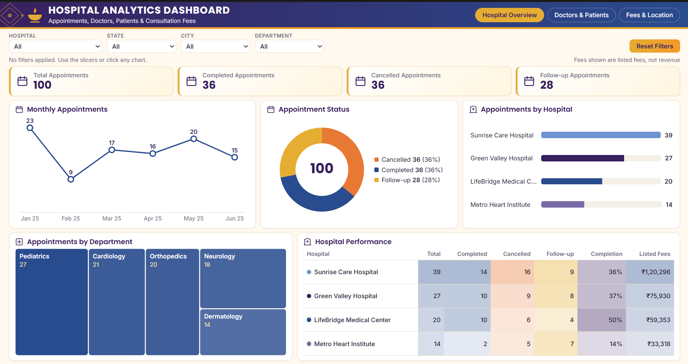
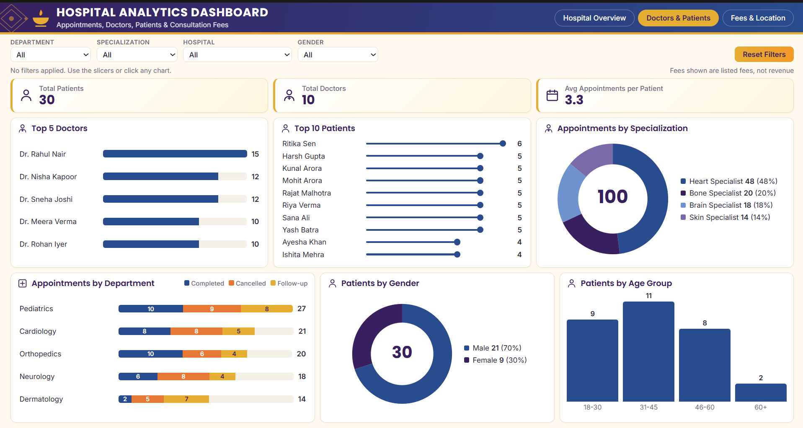
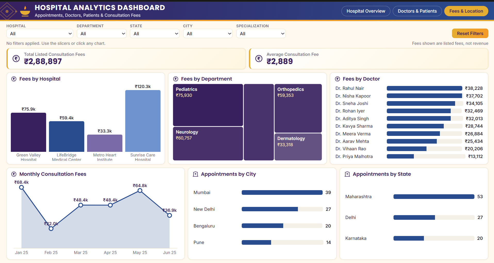
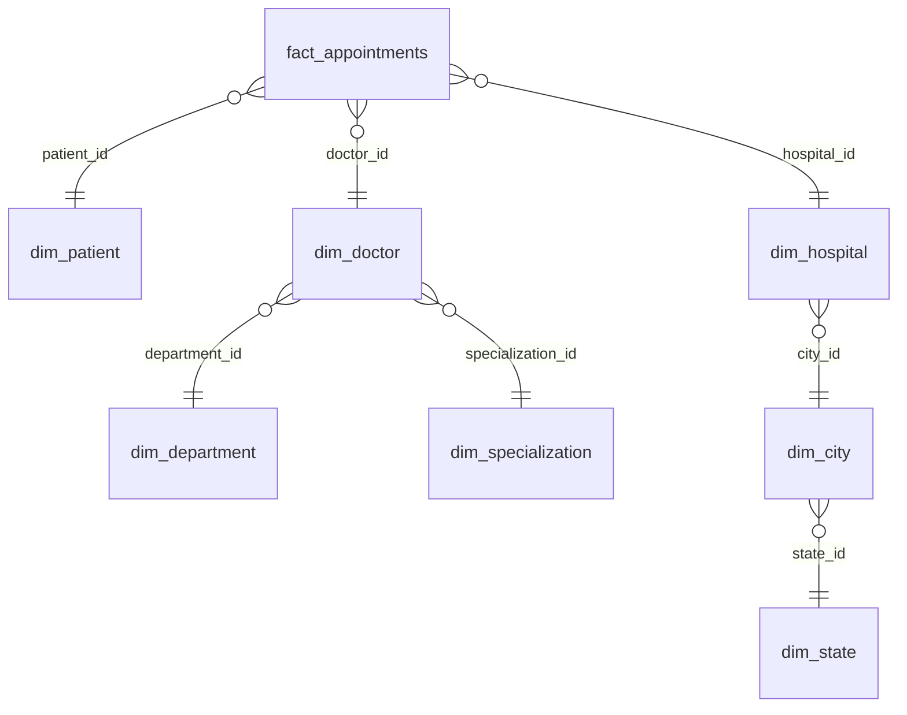

# Hospital Analytics Dashboard

An interactive, 3-page dashboard built with plain **HTML, CSS and JavaScript** on top of a **Snowflake Schema** dataset.
It analyses hospital appointments, doctors, patients and consultation fees across 4 hospitals, 4 cities and 3 states (Jan–Jun 2025).

> Fees shown are **listed consultation fees**, not revenue.

## Dashboard Pages

### Page 1: Hospital Overview


| | |
|---|---|
| **Slicers** | Hospital, State, City, Department |
| **KPIs** | Total, Completed, Cancelled and Follow-up appointments |
| **Visuals** | Monthly trend, status split, appointments by hospital and department, hospital performance table (completion % and listed fees) |
| **Answers** | Which hospital and department are busiest, and how many appointments are actually completed? |

### Page 2: Doctors & Patients


| | |
|---|---|
| **Slicers** | Department, Specialization, Hospital, Gender |
| **KPIs** | Total Patients, Total Doctors, Average Appointments per Patient |
| **Visuals** | Top 5 doctors, top 10 patients, specialization split, status by department, patients by gender and age group |
| **Answers** | Who handles the most appointments, and what does the patient base look like? |

### Page 3: Fees & Location


| | |
|---|---|
| **Slicers** | Hospital, Department, State, City, Specialization |
| **KPIs** | Total Listed Consultation Fees, Average Consultation Fee |
| **Visuals** | Fees by hospital, department and doctor, monthly fee trend, appointments by city and state |
| **Answers** | Where do the highest listed fees come from, and which locations get the most appointments? |

Every chart is clickable: click a bar, slice or row to filter the whole page. Click it again (or use **Reset Filters**) to clear.

## Data Model: Snowflake Schema

This project is built on a **Snowflake Schema**. The central fact table holds the measurable events (appointments and fees).
The dimension tables are **normalised into sub-dimensions**, so no descriptive data is repeated:

- `dim_hospital` → `dim_city` → `dim_state` (location hierarchy)
- `dim_doctor` → `dim_department` and `dim_specialization`



**Why Snowflake?** Hospital location and doctor specialization are hierarchies. Normalising them avoids duplicate text,
keeps names consistent, and lets one change (for example a city rename) update everywhere.
The dashboard rebuilds a flat view with simple joins (see `index.html`, section 1) before drawing charts.

### Dataset (`data/`)

| Table | Type | Rows | Key columns |
|---|---|---|---|
| `fact_appointments` | Fact | 100 | appointment_id, appointment_date, patient_id, doctor_id, hospital_id, status, listed_fee |
| `dim_patient` | Dimension | 30 | patient_name, gender, age, age_group |
| `dim_doctor` | Dimension | 10 | doctor_name, department_id, specialization_id |
| `dim_hospital` | Dimension | 4 | hospital_name, city_id |
| `dim_city` | Sub-dimension | 4 | city_name, state_id |
| `dim_state` | Sub-dimension | 3 | state_name |
| `dim_department` | Sub-dimension | 5 | department_name |
| `dim_specialization` | Sub-dimension | 4 | specialization_name |

The data is **synthetic** (created for learning and portfolio use), with no real patient information.
`data/data.js` is the same data in JavaScript form so the dashboard works by simply opening `index.html`.

## Project Structure

```
hospital-analytics-dashboard/
├── index.html              # Dashboard (HTML + CSS + JS in one file)
├── data/                   # Snowflake schema CSV files + data.js
├── images/                 # 3 dashboard page screenshots
├── scripts/generate_data.py  # Rebuilds the dataset
└── README.md
```

## How to Run

1. Clone the repo: `git clone https://github.com/your-username/hospital-analytics-dashboard.git`
2. Open `index.html` in any browser. No installation is needed.
3. Optional: run `python scripts/generate_data.py` to regenerate the dataset.

To host it online, enable **GitHub Pages** (Settings → Pages → branch `main` → `/root`).

## Tech Stack

HTML5 · CSS3 · Vanilla JavaScript (SVG charts, no libraries) · Python (data generation)

## Author

**Your Name**
GitHub: [your-username](https://github.com/your-username) | LinkedIn: [your-profile](https://www.linkedin.com/in/your-profile)
